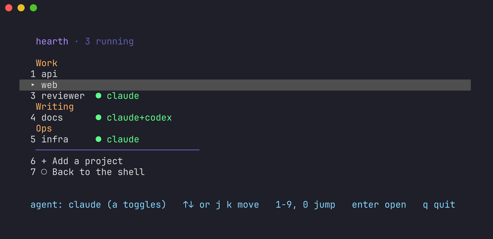

# hearth

Small, honest tools for running a fleet of Claude Code agents: several long-lived sessions, one per role, working side by side in tmux on one machine.

hearth has two tools so far, and will grow as the fleet does:

- **hearth**, a launcher that gives each project its own tmux session and a menu to move between them.
- **embers**, a Stop hook that keeps an idle session's prompt cache warm.

## hearth: one tmux session per project



Pick a project and hearth attaches to its session, starting it first if it isn't running. A new session resumes the agent's last conversation in that directory, or starts a fresh one, and leaves you at a shell when the agent exits. Run inside tmux, hearth switches to the session instead of nesting.

```bash
hearth                         # the menu
hearth start api               # start or attach, from a script or another pane
hearth start api codex         # the same project with Codex, as session "api-codex"
hearth list                    # every project and what's running
hearth add api ~/src/api work  # add a project, optionally under a category
hearth kill api                # end the project's sessions
```

### Install

```bash
mkdir -p ~/.local/bin
cp bin/hearth ~/.local/bin/hearth
chmod +x ~/.local/bin/hearth
```

Make sure `~/.local/bin` is on your `PATH`.

### The registry

Projects live in `~/.config/hearth/projects.conf`, one per line, with fields separated by colons:

```
name:directory:prompt:category:agent:options
```

Only the name and directory are required, and `hearth add` writes those for you. Edit the file by hand for the rest:

| Field | Meaning |
| --- | --- |
| `prompt` | sent to the agent when the session starts |
| `category` | groups projects in the menu and the list, in the order they first appear |
| `agent` | `claude` or `codex` pins the entry to one agent; empty follows the menu's toggle |
| `options` | for Claude, a comma list: `agent=<name>` loads `.claude/agents/<name>.md`, `session=<uuid>` pins the conversation |

Several roles can share one directory. `claude --continue` resumes whichever conversation in a directory ran last, so an entry with `agent=` gets its own conversation instead: hearth derives a stable session id from the entry's name, or uses the `session=` you give it.

```
# a reviewer and a writer working in the same repo
reviewer:~/src/api:Review the open branches.:work::agent=reviewer
writer:~/src/api::work::agent=writer
```

Lines starting with `#` are comments. Because fields are colon-separated, a directory can't contain `:`.

### Settings

| Variable | Default | Meaning |
| --- | --- | --- |
| `HEARTH_PROJECTS` | `~/.config/hearth/projects.conf` | the registry file |
| `HEARTH_AGENT` | `claude` | the agent the menu starts with |
| `HEARTH_CLAUDE_ARGS` | empty | extra arguments for every Claude session |
| `HEARTH_CODEX_ARGS` | empty | extra arguments for every Codex session |

For example, `HEARTH_CLAUDE_ARGS="--model opus"`. hearth never adds permission flags on its own, so sessions ask for permission the way Claude Code normally does unless you pass one here.

### Requirements

python3 (3.9 or later, standard library only), tmux, and `claude` or `codex` on your `PATH`.

## embers: keep an idle session's prompt cache warm

Claude Code caches a session's prompt for a limited time, an hour on many plans. A role session that sits idle for longer pays to rebuild that cache the next time someone wakes it. **embers** is a Stop hook that keeps the cache warm while a session waits:

1. When a turn ends, embers starts one detached timer for that session.
2. If the session's tmux pane stays quiet for 58 minutes, the timer types a one-line ping into the pane ("reply with just ok").
3. Answering the ping reads the cache inside its lifetime, so it stays warm.
4. A turn the ping started counts toward a cap (8 by default). Any real turn resets the count, so a session left idle overnight goes cold after about 8 hours instead of being pinged forever.

It only acts on sessions running in **tmux**. Elsewhere it does nothing.

### Is it worth it?

On API pricing, reading a cached prompt costs about a tenth of the base input price, and writing a one-hour cache costs about twice it. One cold restart therefore costs roughly as much as twenty pings. Keeping a session warm pays off when you'll use it again within a few hours, which is why the cap exists. Your plan's limits may weigh cache reads differently, so watch your usage after you install it, and lower `EMBERS_CAP` if it costs more than it saves.

### Install

```bash
mkdir -p ~/.claude/hooks
cp hooks/embers.sh ~/.claude/hooks/embers.sh
chmod +x ~/.claude/hooks/embers.sh
```

Then add the Stop hook from `examples/settings.json` to the settings of the project or projects whose sessions you want kept warm (for example `.claude/settings.local.json`). Sessions already running may need a restart to pick up a new hook.

### Settings

| Variable | Default | Meaning |
| --- | --- | --- |
| `EMBERS_DELAY` | `3480` | seconds of quiet before a ping |
| `EMBERS_CAP` | `8` | pings in a row before giving up |
| `EMBERS_PING` | `keep-warm ping …` | the text typed into the pane |
| `EMBERS_STATE` | `~/.claude/state/embers` | where per-session state lives |

### How it decides a session is idle

tmux records when a window last changed. A busy session redraws its pane, so embers only pings a pane that has been quiet for the whole delay. A newer turn replaces the pending timer, so each session has at most one ping waiting.

### Requirements

bash, tmux, python3 (only to read the hook's JSON input), and Claude Code with hooks enabled.

## License

MIT. See [LICENSE](LICENSE).
